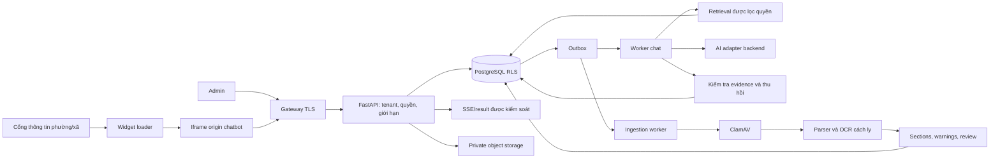

# ĐẶC TẢ SẢN PHẨM VÀ TRIỂN KHAI
# Chatbot hỏi đáp công khai cho cổng thông tin phường/xã

**Phiên bản:** 2.0 — phạm vi rút gọn theo yêu cầu người dùng.
**Ngày:** 13/11/2026, Asia/Saigon.
**Trạng thái:** bộ yêu cầu và phương án để rà soát trước khi code tiếp; không phải biên bản nghiệm thu phần mềm.
**Thay thế:** bản 1.0 ngày 10/11/2026, được giữ nguyên tại [bản lưu lịch sử](docs/archive/2026-11-10-v1/CODEX_CHATBOT_DA_PHUONG_MASTER_SPEC.md).

Người dùng đã xác định sản phẩm chỉ phục vụ hỏi đáp công khai trên cổng thông tin phường/xã. Bản 2.0 là đặc tả hiện hành. Yêu cầu về hồ sơ cá nhân, đăng nhập công dân, Actions và các năng lực mở rộng trong bản 1.0 không còn là điều kiện hoàn thành. Các con số tải, chất lượng, lưu giữ và khôi phục dưới đây là mục tiêu thiết kế/nghiệm thu; chưa phải kết quả đã đo, SLA hay kết luận pháp lý.

## 00. Cách sử dụng bộ tài liệu

1. Đọc đặc tả này, AGENTS.md, docs/IMPLEMENTATION_STATUS.md và docs/IMPLEMENTATION_PLAN.md trước khi sửa.
2. docs/REQUIREMENTS_CHECKLIST.md là bảng truy vết yêu cầu → công việc → kiểm tra → bằng chứng. docs/TEST_REPORT.md giữ lịch sử chạy test, không suy từ lịch sử thành kết quả hiện tại.
3. Các giai đoạn mới dùng mã P0–P5. M0–M8 chỉ dùng để đối chiếu lịch sử; không tái sử dụng tên M4/M5 cho một nội dung khác.
4. Không viết lại nền tảng đang hoạt động chỉ để đổi cấu trúc. Migration tiến, giữ tài khoản, tài liệu và dữ liệu hiện có.
5. DTO Admin từ chối trường lạ. Tenant xác định ở server. Runtime PostgreSQL không sở hữu bảng, không superuser/BYPASSRLS; test RLS bằng PostgreSQL thật.
6. Không ghi secrets vào Git/logs; không reset Git, xóa volume, tự public máy, tạo tài nguyên trả phí hoặc push Git.
7. Lượt công việc hiện tại chỉ chuẩn bị tài liệu. Bắt đầu code ở lượt sau theo yêu cầu người dùng.
8. Nếu tài liệu mô tả kiến trúc hiện có khác với mục tiêu ở đây, đánh dấu khoảng trống và lập việc thực hiện; không coi một tính năng được mô tả là đã có code.

## 01. Mục tiêu và phạm vi

### 01.1. Sản phẩm cần bàn giao

Một nền tảng dùng chung cho nhiều phường/xã. Mỗi đơn vị có một chatbot chính, một Admin đang hoạt động, kho tri thức và bản xuất bản riêng. Người dân mở widget trên cổng thông tin hoặc trang chat độc lập, nhập câu hỏi tiếng Việt và nhận câu trả lời có nguồn kiểm chứng được.

Admin đưa tài liệu vào kho, kiểm tra nội dung/OCR và metadata, xác nhận được phép dùng công khai, xem thử, kiểm tra rồi xuất bản. Chỉ tài liệu trong bản xuất bản của đúng đơn vị, còn hiệu lực và chưa bị thu hồi mới được dùng cho công dân.

### 01.2. Những thành phần phải có

| Mã | Nhóm yêu cầu | Kết quả bắt buộc |
|---|---|---|
| FR-01 | Đa đơn vị | Cách ly cấu hình, tài liệu, chunks/vectors, phiên chat, phản hồi, usage và audit theo tenant |
| FR-02 | Admin | Đăng nhập, đổi mật khẩu, quản lý/thu hồi phiên, MFA production, cấp và bàn giao bằng kênh vận hành |
| FR-03 | Cấu hình nội dung | Tên, mô tả, lời chào, câu gợi ý, Instructions, màu và đầu mối hỗ trợ đã xác minh |
| FR-04 | Nhập tri thức | Văn bản/Markdown an toàn và upload nhiều file có kết quả riêng từng file |
| FR-05 | Xử lý tài liệu | Quét mã độc, parser/OCR, kiểm soát tài nguyên, báo lỗi và độ bao phủ |
| FR-06 | Duyệt và metadata | Sửa extraction có revision, chọn sheet/phần, metadata/nguồn/hiệu lực và xác nhận công khai |
| FR-07 | Kho và phiên bản | Tìm/lọc/phân trang, chi tiết, phiên bản bất biến khi đã xuất bản, so sánh thay đổi cơ bản |
| FR-08 | Xuất bản | Lưu nháp → kiểm tra → xem thử → xuất bản; history, rollback, pause, thu hồi |
| FR-09 | Hỏi đáp | Chat công khai bằng tiếng Việt, xử lý câu hỏi tiếp nối, thiếu nguồn, mơ hồ và mâu thuẫn |
| FR-10 | Nguồn | Dẫn đúng phiên bản/vị trí, mở phần nội dung được phép, kiểm tra lại khi thu hồi |
| FR-11 | Nhúng | Widget dùng được trên cổng thông tin khác tên miền; trang chat độc lập; mobile/bàn phím |
| FR-12 | Độ bền phiên chat | Gửi idempotent, trạng thái đợi/lỗi, SSE reconnect, đọc kết quả và hủy an toàn |
| FR-13 | Phản hồi và tổng quan | Hữu ích/không hữu ích; đếm lượt hỏi, lỗi, thiếu nguồn và trạng thái tài liệu |
| FR-14 | Đánh giá chất lượng | Bộ câu hỏi versioned, kết quả gắn corpus/release/runtime, kiểm tra trước thay đổi |
| FR-15 | Giới hạn sử dụng | Rate limit, số lượt đang xử lý, ngân sách/usage tối thiểu, thông báo hết hạn mức |
| FR-16 | Vòng đời dữ liệu | Thu hồi, purge, retention, orphan cleanup và chống khôi phục dữ liệu đã xóa |
| FR-17 | Cấu hình kỹ thuật | Developer quản lý model/provider/key/embedding/runtime; Admin không xem/chọn/ghi đè |
| FR-18 | Vận hành | Health, logs/metrics an toàn, backup/restore, deployment/rollback và hướng dẫn bàn giao |

### 01.3. Ngoài phạm vi phiên bản này

| Mã | Nội dung | Cách xử lý |
|---|---|---|
| OUT-01 | Đăng nhập/định danh công dân, VNeID/OIDC | Không xây, không yêu cầu IdP để nghiệm thu |
| OUT-02 | Hồ sơ cá nhân, trạng thái hồ sơ, dữ liệu CCCD/số điện thoại | Không tra cứu; hướng đến kênh chính thức đã cấu hình nếu cần |
| OUT-03 | Gửi phản ánh, đặt lịch, ghi hồ sơ hoặc giao dịch | Không có Action/connector thực thi; không báo đã tiếp nhận/thực hiện |
| OUT-04 | Web Search trực tiếp, crawler/đồng bộ website tự động | Để phiên bản sau; Admin upload hoặc nhập nội dung thủ công |
| OUT-05 | File đính kèm do công dân gửi | Người dân chỉ nhập văn bản; upload Knowledge chỉ dành cho Admin |
| OUT-06 | Voice, tạo ảnh, code interpreter, MCP/extensions | Không có menu/nút gây hiểu nhầm là dùng được |
| OUT-07 | Dashboard tài chính/BI sâu, đa vai trò biên tập, quy trình nhiều người duyệt | Giữ tổng quan và kiểm soát chi phí tối thiểu |
| OUT-08 | Làm mới cổng thông tin, Kubernetes/microservices/HA nhiều vùng, model nội bộ mới | Không bắt buộc; triển khai một host có backup và công bố giới hạn |

Hướng dẫn cách làm thủ tục từ tài liệu công khai vẫn thuộc FR-09. Chatbot giải thích giấy tờ/thời hạn theo nguồn, nhưng không tự nộp hồ sơ hay xác nhận trạng thái một cá nhân. Link đến dịch vụ công là link điều hướng thông thường, không phải tích hợp nghiệp vụ.

### 01.4. Giả định đã chọn để lập kế hoạch

- Bản đầu dùng nguồn công khai được kiểm duyệt; chưa chọn địa phương thì dùng corpus quốc gia và corpus địa phương có nhãn riêng cho test.
- Một Admin active/tenant; cấp đơn vị/domain/Admin bằng CLI Developer. Không xây portal quản trị nền tảng mới.
- Giao diện tiếng Việt; FAQ/văn bản dùng Markdown giới hạn, chưa cần rich text editor phức tạp.
- Website sync, voice và Actions không ngầm trở thành yêu cầu vì một thư viện có hỗ trợ.
- Model và giá không hardcode. Chọn model/key/ngân sách và phê duyệt luồng dữ liệu khi bước kiểm thử live cần tới.
- Hạ tầng khởi đầu là single-host Linux Docker; không cam kết HA hoặc một cấu hình máy cụ thể khi chưa đo tải.
- Các mặc định định lượng trong tài liệu có thể điều chỉnh bằng quyết định có ghi nhận sau khi đo; không âm thầm hạ tiêu chí để đánh dấu đạt.

## 02. Vai trò và hành trình

### 02.1. Quyền

| Vai trò | Được làm | Ranh giới |
|---|---|---|
| Developer/Operator | Provision tenant/domain/Admin, runtime/secrets, giới hạn, deployment, xử lý sự cố | Không mặc nhiên đọc toàn bộ nội dung chat; truy cập hỗ trợ phải có lý do và audit |
| Admin đơn vị | Quản lý tri thức/cấu hình nội dung, review, preview, publish, rollback, revoke, xem tổng quan và phản hồi đã che dữ liệu | Chỉ tenant của mình; không model selector, không tenant switcher, không credential hạ tầng |
| Người dân | Chat công khai, mở nguồn đã công bố, đánh giá câu trả lời | Không đăng nhập, không upload, không thao tác nghiệp vụ, không xem chat người khác |

Không đăng nhập công dân vẫn cần token phiên chat ẩn danh để kiểm tra quyền sở hữu session/turn/citation. Public key là định danh công khai, không phải mật khẩu hoặc biện pháp chống lạm dụng.

### 02.2. Luồng Admin

1. Đăng nhập, đổi mật khẩu cấp lần đầu; production yêu cầu MFA.
2. Upload/soạn nội dung; hệ thống hiện job và trạng thái thực.
3. Kiểm tra toàn bộ trang/sheet/phần, cảnh báo OCR, công thức/ô gộp và metadata.
4. Xác nhận nội dung được phép công khai; lưu quyết định ai/phiên bản/revision/thời gian.
5. Chọn phiên bản tài liệu vào nháp; lưu nháp và xem thử có nhãn rõ.
6. Kiểm tra điều kiện xuất bản, xem thay đổi và nguồn/hiệu lực.
7. Publish với lý do; chỉ chuyển active release khi transaction hoàn tất.
8. Khi sai: pause hoặc revoke ngay; sửa bằng phiên bản mới; rollback không gỡ bỏ thu hồi.

### 02.3. Luồng người dân

Mở widget → thấy tên phường/xã và thông báo AI → nhập câu hỏi → thấy trạng thái → nhận trả lời/nguyên nhân chưa trả lời → mở thẻ nguồn → đánh giá.

Thông báo đầu: không nhập CCCD, tài khoản, hồ sơ hoặc thông tin nhạy cảm; không yêu cầu những dữ liệu đó để hỏi đáp. Lỗi/hết hạn mức phải có lời giải thích dễ hiểu và đường đến đầu mối hỗ trợ có thật nếu đã cấu hình. Khi đơn vị chưa xuất bản, trả trạng thái chưa sẵn sàng, không tự dùng tài liệu nháp/phường khác.

## 03. Kiến trúc và dữ liệu

### 03.1. Giữ baseline hiện có

| Thành phần | Phương án |
|---|---|
| UI | Next.js/React/TypeScript, trang /admin, /chat/{public_key}, /embed/{public_key} |
| Widget | Loader nhỏ tạo iframe từ origin chatbot; CSS cổng thông tin không tràn vào chat |
| Backend | FastAPI/Pydantic/SQLAlchemy; API và worker dùng chung logic nghiệp vụ |
| Database | PostgreSQL/pgvector, lexical tiếng Việt + hybrid retrieval |
| Jobs | Celery/Redis và outbox bền vững trong PostgreSQL |
| Files | Private S3-compatible storage; MinIO local hiện có cần review riêng trước production |
| Parser/OCR | Worker/queue riêng, ClamAV, subprocess bị giới hạn, Tesseract vie+eng |
| AI | Adapter backend hiện có; Mock cho local/test, adapter thật kiểm chứng riêng |
| Gateway | Nginx/TLS, trust proxy có giới hạn, chính sách nhúng theo tenant |
| Công cụ | pnpm/uv và lockfiles; migration Alembic; Docker; pytest/Playwright |

Không nâng dependency hoặc thay storage trong lượt chuẩn bị đặc tả. Khi triển khai, kiểm tra tài liệu chính thức theo phiên bản khóa và đánh giá license/CVE của thành phần thực dùng.

### 03.2. Luồng xử lý

Cấm giữ DB connection/transaction trong thời gian gọi chat AI hoặc query embedding. Embedding query tách khỏi transaction; sau đó mở transaction mới và kiểm tra release/profile/quyền/thu hồi trước query, kiểm tra lại trước công bố.

### 03.3. Hợp đồng dữ liệu

Giữ các bảng hiện có về tenant, membership/session Admin, assistant/draft, documents/versions/sections/chunks/embeddings, release, chat, citations/events/feedback/outbox/audit. Bổ sung bằng migration tiến khi cần:

| Nhóm | Dữ liệu cần có |
|---|---|
| Domain | tenant, origin chuẩn hóa, trạng thái active, người cấp/thời điểm, lịch sử thay đổi |
| Metadata | số/ký hiệu, cơ quan, ngày ban hành/hiệu lực, phạm vi áp dụng, URL nguồn, hash gốc, ngày thu thập, tag, quan hệ thay thế |
| Review | version + revision + selected sections + warnings acknowledged + actor/time |
| Evaluation | dataset/version/hash, cases, expected evidence/behavior, corpus/release/runtime fingerprints, kết quả/chấm/reviewer |
| Usage/budget | operation ID, tenant, loại chat/query embedding/indexing, reservation, usage thực, trạng thái giá và đối soát |
| Lifecycle | deletion/tombstone/retention jobs, object manifest, checkpoint, backup cutoff |
| Admin security | MFA secret được mã hóa, recovery hash, revocation/rotation audit |

RLS bắt buộc cho mọi bảng tenant-owned mới. Catalog embedding/pricing global chỉ Developer ghi. Liên kết tài nguyên dùng composite tenant FK. IDs là opaque UUID, timestamp lưu UTC và hiển thị giờ Việt Nam.

### 03.4. Tenant và cache

- Admin tenant từ session đã xác thực; public tenant từ directory public_key, rồi gắn vào chat session.
- Body/query không được đặt tenant_id để đổi phạm vi. Kiểm tra IDs theo session/tenant kể cả khi RLS đã bật.
- Transaction-local app.tenant_id; thiếu context default-deny; runtime không sở hữu bảng.
- Object key có tenant/version; bucket private. Không cho client tự quyết object key.
- Cache nếu có phải chứa tenant, release hash, runtime/profile, mode và security epoch; invalidation khi revoke/purge/pause.
- Chưa có nhu cầu đo được thì không thêm answer cache. Lịch sử chat/Preview không dùng chung cache với public.

## 04. Tài liệu và quản lý tri thức

### 04.1. Định dạng và giới hạn ban đầu

| Định dạng | Locator và yêu cầu |
|---|---|
| PDF text/scan | Trang vật lý, số trang đã xử lý, OCR từng trang cần OCR, cảnh báo layout |
| DOCX | Heading/mục/bảng; không bịa số trang |
| XLSX | Sheet, vùng ô, hàng; giữ header/đơn vị/context và quan hệ ô gộp |
| PPTX | Slide và phần/bảng |
| TXT/MD | Mục/đoạn/dòng phù hợp |
| CSV | Hàng/cột, delimiter/encoding có cảnh báo khi suy đoán |
| HTML upload | Trích text an toàn; không chạy script và không tự tải URL/assets ngoài |
| PNG/JPG | OCR có locator ảnh, cảnh báo và review |

Giữ các định dạng đã có để tránh làm mất chức năng. Từ chối rõ .doc/.xls/.xlsm, executable, archive tùy ý, encrypted/password-protected hoặc định dạng không hỗ trợ. Không chạy macro, external links hoặc công thức.

Baseline giới hạn hiện có: 25 MiB/file, 10 file/batch, PDF 300 trang, ảnh 25 megapixel, XLSX 100 sheet/100.000 hàng, giải nén 100 MiB, extracted text 8 MiB/job, 10.000 section/job. Phải đếm cả độ bao phủ và giới hạn bộ nhớ/thời gian; quá giới hạn trả lỗi và gợi ý chia file. Kích thước request gateway/API/multipart thống nhất, kiểm tra bytes thực khi không có Content-Length.

Các số này là trần bảo vệ, không cam kết tài liệu tối đa xử lý trong một thời gian cụ thể. Thay đổi trần cần đo tài nguyên và cập nhật tài liệu/test.

### 04.2. State machine và độ bền

uploaded → scanning → extracting → needs_review/indexing → ready.
Nhánh lỗi: failed/quarantined; retry có kiểm soát. Review bắt buộc khi OCR, cảnh báo trích xuất/encoding/table/formula/hidden sheets hoặc thay đổi chọn phạm vi.

scan_status, parse_status, review_revision, approval và release membership là các chiều riêng. ready không có nghĩa public. Một file lỗi không làm cả batch thành công giả hoặc mất trạng thái file khác.

- Batch upload có client_request_id và fingerprint; retry cùng payload không tạo version/object/job trùng; dùng lại ID với payload khác trả conflict.
- Cùng nội dung nhưng người dùng chủ động tạo version mới là thao tác riêng có xác nhận, không âm thầm gộp giữa tenant.
- Outbox có unique operation; worker claim/lease/fencing, checkpoint; crash/retry không nhân chunk hoặc hồi sinh nội dung purge.
- Scanner unavailable/signature quá hạn theo policy thì fail closed; file chưa sạch không được tải gốc hoặc dùng để trả lời.
- Parser không có DB/key/Internet, chỉ nhận bytes/job metadata cần thiết; timeout/CPU/RAM/PID/temp/output limits; dọn file tạm.
- Job UI hiển thị processing/failed/retry và mã lỗi an toàn; không hiển thị progress phần trăm giả.

### 04.3. Review, metadata và phiên bản

Bắt buộc: title, nguồn gốc tài liệu (upload/văn bản), phân loại dữ liệu, review status, người/thời gian duyệt. Số văn bản, cơ quan, issued_on, effective_from/to, source_url, jurisdiction, topic_tags và supersedes_version_id được hỗ trợ, cho phép null khi chưa biết; không lấy ngày upload làm ngày ban hành.

Chuẩn tên trường theo schema hiện có khi hợp lý (issuer, issued_on); UI tiếng Việt. Không tự đổi tên API cũ nếu chưa có migration/compatibility plan.

XLSX phải hiển thị sheet ẩn/công thức/cached value; sheet ẩn không chọn công khai mặc định. Không có cached value thì cảnh báo và không bịa số. Bảng chunk theo hàng, lặp tiêu đề/đơn vị; hàng quá rộng phải báo lỗi thay vì cắt hỏng quan hệ dữ liệu.

Thay extraction hoặc metadata ảnh hưởng nội dung/hiệu lực làm mất approval, tăng revision. Phiên bản đã nằm trong release bất biến; sửa bằng version mới. Mọi review/publish dùng optimistic revision; stale tab nhận conflict.

Chỉ nội dung được xác nhận public mới được gửi tới provider ngoài theo data policy đã duyệt. Preview tài liệu chưa được phép gửi ra ngoài phải báo chưa đủ điều kiện; không dùng Mock thay AI thật trong production để giả rằng Preview đã được kiểm thử.

### 04.4. Thu hồi và xóa

Revoke có hiệu lực ngay với retrieval, cache, answer chưa phát, result/source/SSE đọc lại. Rollback không gỡ revoke. Nội dung đã tải về/chụp màn hình ngoài hệ thống không thể thu hồi bằng API.

Purge là job riêng sau revoke: object, sections/review text, chunks/vectors, cache và derived answer liên quan; giữ IDs/tombstone/audit tối thiểu để release history không phá FK. Có retry và báo pending/failed/completed thật.

Orphan sweeper đối chiếu DB/object manifest, dùng grace period và dry-run; không xóa object đang upload/job còn lease. Backup/provider copy có policy riêng; không tuyên bố purge đã xóa mọi bản sao. Sau restore phải áp dụng deletion ledger trước khi mở public.

## 05. Retrieval và câu trả lời

### 05.1. Chính sách nguồn

Public chỉ truy xuất version thuộc release đang dùng của đúng tenant, ready, scan sạch/không cần scan, review/approval hợp lệ, trong thời gian hiệu lực, chưa revoke/purge. Không dùng draft, nguồn tenant khác hoặc kết quả web ngoài corpus.

Hybrid dùng lexical tiếng Việt + exact cosine pgvector/RRF hiện có. Đánh giá recall/latency trước khi thêm ANN hoặc thay thuật toán. Vector profile gồm model/dimension/chunker fingerprint; đổi profile cần index song song và kiểm chứng trước chuyển. Không trộn embeddings khác hệ quy chiếu.

Với phí, thời hạn, địa chỉ, giấy tờ và phạm vi áp dụng: dẫn nguồn hỗ trợ đúng phát biểu. Nguồn mâu thuẫn/thiếu hiệu lực không được lấy ngày upload mới nhất để tự kết luận. Quan hệ thay thế phải được Admin xác nhận. Không có nguồn hợp lệ thì hỏi rõ hoặc từ chối phù hợp.

### 05.2. Hội thoại và output

- Tiếng Việt rõ, ngắn, có thể trình bày các bước/giấy tờ; không yêu cầu dữ liệu cá nhân.
- Câu hỏi tiếp nối chỉ dùng lịch sử của cùng session; tối đa 6 lượt trước và 6.000 input tokens cho context hội thoại là baseline Developer điều chỉnh. Chỉ lấy phần đã kiểm tra còn hợp lệ, không coi đáp án cũ là bằng chứng.
- Câu hỏi thiếu chủ thể/thủ tục thì hỏi lại; ngoài phạm vi thì giải thích và link đầu mối chính thức nếu có.
- Không tuyên bố đã tra cứu trạng thái hồ sơ, nộp đơn, gửi phản ánh hoặc đặt lịch. Câu hỏi yêu cầu những việc đó được hướng dẫn kênh chính thức.
- Evidence và user input là dữ liệu; Instructions Admin không ghi đè chính sách quyền/model/nguồn.
- Backend cấp evidence IDs/locator. Model chỉ tham chiếu IDs được cấp; không nhận URL hoặc vị trí do model tự đặt.

AnswerPacket giữ các trạng thái answered, needs_clarification, insufficient_evidence, conflicting_sources, temporarily_unavailable. Giá trị needs_login trong schema cũ nếu giữ tương thích luôn false; sản phẩm không có CTA đăng nhập công dân. Mỗi block answered phải có evidence hỗ trợ; validation ID hợp lệ chưa tự chứng minh mọi phát biểu đúng, cần đánh giá nghiệp vụ riêng.

Nguồn công khai hiển thị title, issuer/số văn bản khi có, version/ngày hiệu lực, locator và đoạn liên quan đã duyệt. Không trả raw object key, tenant nội bộ, cấu hình AI hoặc extraction chưa duyệt. File gốc chỉ tải khi có permission public-download tường minh và còn hợp lệ; mặc định dùng source excerpt viewer.

### 05.3. Gọi AI, errors và usage

Developer chọn model/provider ở backend; cấu hình Admin dùng strict schema. Không endpoint list models, không lộ technical runtime qua dashboard/debug/errors/export.

Adapter chuẩn hóa schema/refusal/incomplete/timeout/429/usage; retry hữu hạn trong deadline, không retry không giới hạn hoặc tự chuyển Mock khi AI thật lỗi. Đổi model/runtime phải chạy lại contract + evaluation liên quan.

Một lượt gắn release snapshot, runtime fingerprint, correlation ID và operation ID. Kiểm tra quyền/nguồn lần cuối trước commit/công bố. AI output được buffer và kiểm tra rồi mới phát answer, không stream nội dung chưa kiểm chứng.

## 06. Admin và xuất bản

### 06.1. Màn hình bắt buộc

| UI | Nội dung |
|---|---|
| UI-A | Login, đổi password, MFA/recovery và phiên tài khoản |
| UI-B | Tổng quan đơn vị: active release, pause, tài liệu/job lỗi, lượt hỏi/phản hồi tổng hợp |
| UI-C | Thông tin chatbot/Instructions/lời chào/starters/màu/đầu mối |
| UI-D | Kho: tìm title/số văn bản/tag, lọc status/type/approval/hiệu lực; phân trang |
| UI-E | Chi tiết tài liệu: metadata, sections, review, versions và diff cơ bản |
| UI-F | Preview: hỏi draft, nguồn, cảnh báo, trạng thái test; không raw reasoning |
| UI-G | Kiểm tra/xuất bản: lỗi chặn, diff, history, lý do publish/rollback |
| UI-H | Nhúng: copy snippet đã gắn đúng public_key/origin, preview desktop/mobile, domain được cấp |
| UI-I | Sử dụng cơ bản/phản hồi và audit nội dung đã làm sạch |

Có thể ghép các UI thành tab, không bắt buộc chín trang riêng. Không menu citizen login, Actions, Capabilities nâng cao hoặc model selection. Đếm dashboard từ dữ liệu thật; không hardcode biểu đồ/trạng thái.

Kho dùng page size mặc định 20, tối đa 100; không dùng trần 200 phiên bản để âm thầm bỏ tài liệu. Sắp xếp ổn định theo updated_at/id, filter server-side và RLS trước pagination.

### 06.2. Kiểm tra và publish

Preflight phải kiểm tra: revision/hash đúng, tài liệu ready/scan/review/approval, hiệu lực, phạm vi tenant, nguồn chưa thu hồi, vector đủ/profile đúng khi runtime dùng embeddings, cấu hình hỗ trợ và runtime fingerprint, giới hạn và kết quả evaluation phù hợp khi được yêu cầu.

Kết quả validation gắn draft hash/runtime/corpus hash và hết hạn 30 phút theo baseline. Thay draft/runtime/nguồn làm mất giá trị validation. Trong transaction publish khóa assistant, kiểm tra lại điều kiện thay đổi được, tạo immutable snapshot rồi đổi active pointer. Không giữ transaction qua lời gọi AI/evaluation.

Bản publish đầu và thay runtime/retrieval cần evaluation đầy đủ. Với cập nhật nội dung thường ngày: chạy nhóm câu hỏi liên quan và bộ smoke an toàn đã gắn hash; có thay đổi phải bổ sung case. Bộ evaluation đầy đủ chạy trước release phần mềm và trước go-live. CLI/report là đủ cho v2; không bắt buộc làm evaluation dashboard lớn.

Rollback tạo quyết định/audit mới trỏ snapshot nội dung cũ sau khi kiểm tra chính sách hiện tại; không hạ runtime/secrets/quyền an toàn. Nếu tài liệu cũ đã revoke/không còn hiệu lực/profile không phù hợp thì chặn rõ.

## 07. Widget và tích hợp cổng thông tin

### 07.1. Phương án được chọn

Một backend chatbot dùng chung, mỗi đơn vị có public_key. Website phường nhúng loader từ origin chatbot qua HTTPS; loader tạo iframe /embed/{public_key}. Chat/API/source viewer nằm cùng origin chatbot. Không tích hợp database/cookie/SSO của cổng thông tin.

Loader suy origin từ script.src, không từ URL nhập tùy ý. Hỗ trợ nhiều origin cổng thông tin do Developer cấp rõ; loại bỏ giới hạn same-origin hiện tại sau khi có kiểm soát domain và browser tests.

Có hướng dẫn hai cách nhúng: script loader là chính; iframe trực tiếp/trang chat là phương án thay thế khi CSP của cổng chặn script bên ngoài. Đội cổng cấu hình script-src/frame-src chính xác cho origin chatbot.

### 07.2. Chính sách an toàn

- Allowlist exact origin https://host[:port], không wildcard tùy ý; HTTP chỉ local/test. Thay domain có audit và kiểm tra quyền sở hữu qua quy trình vận hành.
- HTTP response của trang embed có CSP frame-ancestors theo tenant; Admin dùng frame-ancestors 'none'. Header phải được áp dụng trên HTML embed ở gateway/web, không chỉ API hay thẻ meta.
- X-Frame-Options không đặt SAMEORIGIN trên embed cần nhúng khác origin; admin có chính sách riêng. Không vô hiệu hóa mọi CSP để khắc phục.
- Nếu dùng postMessage cho resize/close: kiểm tra event.origin, event.source, schema; targetOrigin exact, không '*'; chỉ truyền UI events, không truyền token/chat/credentials cho parent.
- Anonymous session dùng bearer token trong memory của iframe, không query string, không cookie bên thứ ba; không phụ thuộc đăng nhập parent. Reload tạo phiên mới là hành vi được chấp nhận của v2.
- Admin cookie Secure/HttpOnly/SameSite và CSRF/Origin vẫn bắt buộc; không nới Admin CORS vì widget.
- Allowlist nhúng không phải cơ chế xác thực public API; dùng rate/budget limits để kiểm soát lạm dụng. Không coi Origin/Referer/IP là định danh công dân.
- Proxy chỉ tin forwarded headers từ gateway được cấu hình, chống giả X-Forwarded-For để né rate limit.

### 07.3. UX và nghiệm thu tích hợp

Nút mở/đóng, focus quay về nút khi đóng, Escape, nhãn truy cập, viewport 360/390 px không tràn, nguồn đọc được trên mobile. Loader không chặn trang chủ và báo link chat khi tải thất bại.

Kiểm tra hai website mẫu khác origin, hai tenant, origin không cấp phép, third-party cookies bị chặn, browser desktop/mobile; Chrome/Edge/Firefox và Safari/iOS có kết quả thực tế trước rollout trên đối tượng tương ứng. Hai origin mô phỏng chỉ chứng minh kỹ thuật; cổng thật vẫn cần nghiệm thu P5.

## 08. Hợp đồng API mục tiêu

Giữ prefix /api/v1 và response schema hiện có khi phù hợp; OpenAPI là nguồn sinh TypeScript. Bảng sau nêu hành vi bắt buộc, endpoint mở rộng mới phải được ghi trong docs/API.md khi code.

| Nhóm | Hành vi |
|---|---|
| /auth/admin/*, /auth/me, /auth/logout | Session Admin, password, MFA, recovery/session revoke |
| /admin/assistant, /draft | Cấu hình nội dung và optimistic revision |
| /admin/knowledge/documents, /texts, /versions | List/filter/page/detail và văn bản/version |
| /admin/knowledge/uploads, /jobs/{id}, /retry | Multipart batch idempotent, job status/retry |
| /admin/knowledge/versions/{id}/metadata, /review, /original | Review/metadata revision và original private |
| /admin/knowledge/.../approve-public, /revoke, /delete-request, /deletions | Approval, revoke, purge status |
| /admin/releases/validate, /releases, /{id}/rollback | Preflight, publish/history/rollback |
| /admin/assistant/pause, /dashboard, /audit | Điều khiển và tổng quan trong tenant |
| /public/assistants/{key}, /sessions | Cấu hình công khai tối thiểu và session ẩn danh |
| /admin/assistant/preview/sessions | Preview gắn phiên Admin/revision |
| /chat/sessions/{id}/turns | POST idempotent, 202 + turn ID; một live turn/session |
| /chat/turns/{id}, /events, /cancel, /feedback | Result/SSE recovery/cancel/feedback theo session |
| /sources/{citation_id} | Source excerpt theo citation ownership và policy hiện tại |
| /health/live, /health/ready | Liveness/readiness tối thiểu, không secrets |

Session ẩn danh mặc định 2 giờ. Token chỉ lưu hash server-side. Preview hết hiệu lực khi session Admin bị revoke/logout hoặc draft snapshot không còn được phép sử dụng.

SSE event ID tăng dần, replay kiểm tra ownership/revocation, heartbeat và reconnect hữu hạn; đọc terminal result khi stream lỗi. Client không tự tạo request_id mới chỉ vì POST timeout; truy hồi cùng request_id để tránh gọi AI trùng.

HTTP errors: 401 phiên không hợp lệ, 403 cấm, 404 resource ngoài phạm vi, 409 stale/conflict/paused, 413 quá lớn, 422 schema, 429 giới hạn, 503 dependency/AI unavailable. Error envelope có code/message/request_id/retryable, không raw SQL/provider error. Bổ sung mã BUDGET_EXCEEDED/PRICING_UNAVAILABLE khi cần, có backward compatibility.

Những field cũ về attachments/needs_login/capabilities nếu giữ tương thích phải bị khóa giá trị an toàn. Không cần xóa bảng hoặc breaking API để loại chức năng chưa dùng; public/admin DTO không quảng bá chức năng ngoài phạm vi.

## 09. Bảo mật, riêng tư và giới hạn chi phí

### 09.1. Các yêu cầu phi chức năng

| Mã | Yêu cầu |
|---|---|
| NFR-01 | Cách ly tenant và ownership xuyên DB, worker, source, SSE, object/cache |
| NFR-02 | Bảo mật Admin, secrets/DTO, TLS/CSP/CSRF và parser/upload |
| NFR-03 | Câu trả lời có bằng chứng, kiểm thử chất lượng AI thật và dữ liệu có thẩm quyền |
| NFR-04 | Độ bền outbox/worker, idempotency, recovery và thu hồi hiện hành |
| NFR-05 | Hiệu năng được đo trên workload/hạ tầng rõ ràng, tách platform/provider/OCR |
| NFR-06 | Kiểm soát lạm dụng/chi phí, không vượt đồng thời do race trong ứng dụng |
| NFR-07 | Tối thiểu hóa dữ liệu, retention và deletion/restore nhất quán |
| NFR-08 | Khả năng sử dụng/accessibility và nhúng khác origin |
| NFR-09 | Triển khai tái lập, backup/restore, monitoring và runbooks |
| NFR-10 | Báo cáo trung thực, truy vết yêu cầu/phiên bản/test và phân biệt local/live/UAT |

Admin production dùng MFA TOTP, recovery codes hash, secret mã hóa bằng key vận hành, reset có xác minh và audit; không endpoint public reset bỏ qua xác thực. Một Admin active không có nghĩa dùng chung mật khẩu.

Không log prompt/câu hỏi đầy đủ/token/PII theo mặc định. Metrics dùng ID kỹ thuật với cardinality được kiểm soát; lỗi được redact. Admin feedback UI che thông tin cá nhân; không xây chức năng đọc toàn bộ hội thoại nhạy cảm.

Người dân có thể tự nhập PII dù chatbot không yêu cầu. Tối thiểu hóa context gửi AI, che các mẫu nhận diện rõ trước gửi/lưu theo policy, thông báo giới hạn; không hứa phát hiện mọi PII. Nguồn nội bộ/restricted không đưa vào kho public, không gửi provider ngoài bằng Preview.

### 09.2. Sử dụng và ngân sách tối thiểu

Không làm BI tài chính sâu, nhưng production phải có giới hạn request, số turn active, usage ledger và budget backend.

- Rate limits theo IP đã xử lý trust proxy, session và tenant; daily/monthly limit cho tenant và global do Developer đặt.
- Baseline ban đầu để đo: 5 turn/phút/session, 30 turn/phút/IP, 120 turn/phút/tenant, 1 active turn/session; ngưỡng cấu hình lại sau benchmark. IP NAT không phải một người; lỗi có Retry-After.
- Mỗi lời gọi có thể tính phí: reserve atomic theo operation ID, maximum input/output/embedding units; kiểm tra phần dư trước gọi; reconcile usage thực sau kết quả.
- Retry, query embedding và indexing đều tính vào ledger; budget indexing tách chat để upload không làm cạn quota trả lời ngoài dự kiến.
- Không có bảng giá đã xác minh thì hiển thị unknown/unpriced; không coi là 0. Production paid operation thiếu pricing/budget phải fail closed; local Mock không bị giả là live cost.
- Crash/timeout có thể đã bị tính phí: giữ reservation trạng thái unknown, đối soát rồi mới giải phóng; không retry mù hoặc hoàn tiền chắc chắn.
- Redis unavailable: chặn tạo paid operations mới nếu không còn kiểm soát; result đã lưu vẫn có thể đọc theo ACL.
- Admin chỉ thấy lượt dùng/hạn mức/trạng thái phù hợp, không model/provider/key. Operator có số liệu kỹ thuật riêng.
- Budget ứng dụng cần kèm giới hạn/cảnh báo provider nếu có; không cam kết hóa đơn bên ngoài tuyệt đối bằng số ước tính nội bộ.

### 09.3. Retention và backup

Mặc định lập kế hoạch, phải được đơn vị duyệt trước public:

| Dữ liệu | Mặc định |
|---|---|
| Raw chat và feedback text | Tối đa 30 ngày; giảm thêm nếu mục đích không cần |
| Phiên/token ẩn danh | Hết hạn 2 giờ; dọn theo lịch, không dùng hết hạn phiên để coi raw chat đã xóa |
| Audit đã che nội dung | 180 ngày |
| Usage tổng hợp không PII | 365 ngày |
| File tạm parser | Dọn ngay khi job xong/lỗi; sweeper tối đa 24 giờ |
| Backup mã hóa | Luân chuyển tối đa 30 ngày, có deletion ledger |
| Tri thức đang dùng | Giữ theo vòng đời nội dung/đơn vị; thu hồi và purge là thao tác riêng |

Jobs idempotent, batch có hạn, metric backlog, dry-run và kiểm tra chéo tenant. Backup tách nơi lưu và quyền truy cập; keys phục hồi được quản lý riêng. Provider retention được kiểm tra theo dịch vụ/hợp đồng thực dùng; store=false không tự có nghĩa không có lưu giữ ở mọi lớp.

## 10. Chất lượng AI và bộ nguồn

### 10.1. Thu thập nguồn

Chọn nguồn do cơ quan có thẩm quyền công bố. Với mỗi file lưu URL trang công bố, URL file, cơ quan/phạm vi, ngày thu thập, SHA256, số/hiệu lực nếu có, quan hệ văn bản thay thế và trạng thái review.

Tài liệu từ hai địa phương chỉ dùng trong tenant tương ứng; nguồn quốc gia muốn dùng chung phải được nạp/version/duyệt rõ ở mỗi tenant trong v2, không thêm kho global bỏ qua RLS.

Có thể tự tìm và tải nguồn công khai cho local test. Việc này là chuẩn bị corpus có giới hạn, không phải tính năng crawler. Download thủ công hoặc script allowlist được kiểm soát, kiểm MIME/size/redirect; không tự fetch source_url do Admin nhập trong API.

Các nguồn đã tìm thấy để tuyển chọn, chưa chứng nhận hiệu lực hay chất lượng toàn bộ file:
- [Thủ tục khai sinh trên Cổng DVCQG](https://dichvucong.gov.vn/p/home/dvc-chi-tiet-thu-tuc-dung-chung.html?ma_thu_tuc=1.001193).
- [Công báo Chính phủ: trang Nghị định 301/2026/NĐ-CP, PDF/DOCX](https://congbao.chinhphu.vn/van-ban/nghi-dinh-so-301-2026-nd-cp-470197.htm).
- [UBND Xuân Định: danh mục công khai có PDF/XLSX](https://xuandinh.dongnai.gov.vn/vi/news/bo-thu-tuc-hanh-chinh/cong-khai-danh-muc-thu-tuc-hanh-chinh-thuoc-tham-quyen-giai-quyet-cua-ubnd-cap-xa-916.html).

Corpus mục tiêu đầu: tối thiểu 20 tài liệu, 5 nhóm nội dung và hai tenant; đủ các dạng PDF text, scan tiếng Việt, DOCX, XLSX và text/FAQ. Định dạng khó chưa có nguồn public phù hợp dùng fixture có nhãn riêng, không trình bày fixture là văn bản chính thức.

### 10.2. Evaluation

Bộ regression ban đầu >=50 case; trước P5 >=200 case, có review nghiệp vụ. Baseline phân bố: 100 câu có đáp án, 30 câu tiếp nối/mơ hồ, 25 ngoài phạm vi/không có nguồn/cá nhân, 20 nguồn hết hiệu lực/thu hồi/mâu thuẫn, 25 adversarial/cách ly/prompt injection. Retrieval recall đo trên subset có expected evidence.

Mỗi case có ID, tenant, question/history, expected behavior, required facts, allowed evidence version/locator, forbidden claims, mức nghiêm trọng, nguồn căn cứ, người review. Tách bộ development với holdout ít nhất 20%; không dùng đáp án đánh giá làm nguồn retrieval.

Mỗi lần chạy ghi dataset/corpus/draft/release/runtime/embedding fingerprint, ngày giờ, cấu hình nonsecret, usage/cost, latency, raw result đã làm sạch và người chấm. Không dùng model tự chấm làm bằng chứng duy nhất. Contract test/Mock vector chỉ chứng minh đường đi dữ liệu.

### 10.3. Ngưỡng nghiệm thu

| Chỉ tiêu | Mục tiêu |
|---|---|
| Rò tenant/secret, public dùng draft/revoked, thực thi nghiệp vụ ngoài phạm vi | 0 lỗi trong bộ kiểm tra bắt buộc |
| Citation hiển thị resolve đúng quyền/version/locator | 100% trên tập đánh giá |
| Retrieval recall@8 trên subset có đáp án | >=90% |
| Đúng và đủ nghiệp vụ theo rubric con người | >=95% trên subset có đáp án, công bố số mẫu/mẫu số |
| Từ chối/hỏi rõ đúng ở subset tương ứng | >=95%, công bố từng nhóm |
| Mọi phát biểu thực chất được nguồn hỗ trợ (groundedness) | >=95% theo rubric và người chấm |
| Lỗi trọng yếu về phí/thời hạn/đầu mối/khẳng định nghiệp vụ đã thực hiện | 0 lỗi chưa xử lý trong bộ nghiệm thu |

Case an toàn fail chặn go-live dù điểm trung bình đạt. Không diễn giải tỷ lệ trên dataset thành bảo đảm đúng với mọi câu hỏi. Không hạ mục tiêu bằng cách loại các case khó sau khi xem kết quả; thay dataset phải version và lý do.

## 11. Hiệu năng và độ ổn định

### 11.1. Workload baseline

Dùng để thiết kế bài đo, chưa phải lưu lượng cam kết: 10 tenant, tổng 100.000 chunks (khoảng 10.000/tenant), 30 turn chat đang xử lý đồng thời trên hệ thống; một tenant nóng nhận ít nhất 50% tải. Kho có dữ liệu thật và fixture có nhãn, vector/filter/approval/revocation thực.

Báo cáo cấu hình CPU/RAM/disk/network, số worker và DB pool, corpus/profile, request rate, active turns, thời gian warm-up/đo, errors, queue và percentiles. Concurrency không đồng nghĩa request/giây. Không mặc định stack local hiện tại chịu được workload này.

### 11.2. Mục tiêu kiểm tra

| Hạng mục | Mục tiêu thiết kế |
|---|---|
| Endpoint nhẹ/create-turn không gồm model | p95 <=1 giây ở tải baseline |
| Retrieval DB sau khi có query vector | p95 <=500 ms trên corpus baseline |
| Chờ queue chat | p95 <=5 giây; backlog giảm về bình thường sau burst |
| Kết quả cuối với adapter latency cố định 2 giây | p95 <=15 giây, bài đo platform-only |
| Live chat | Mục tiêu p95 <=30 giây trên mẫu được phép; báo riêng provider/embedding/queue; chưa đạt phải tối ưu/đổi cấu hình có đánh giá trước nghiệm thu |
| Lỗi ngoài chủ đích | <1% trong workload hợp lệ; báo riêng 429 chủ động và provider error, không bỏ chúng khỏi báo cáo |
| Độ bền | 30 phút tải baseline + 2 giờ soak với adapter mô phỏng, không leak pool/memory hoặc job mất |
| Backup/restore | RPO mục tiêu <=24 giờ, RTO <=4 giờ, phải đo restore thật |

Cấu hình benchmark giả lập không được gọi là số đo AI thật. Live benchmark opt-in và có ngân sách. OCR/ingestion đo riêng PDF text/scan/XLSX ở các kích thước 10/50/100 trang hoặc số hàng tương ứng; công bố thời gian/tài nguyên, không hứa SLA xử lý file khi chưa có số đo. Trong lúc OCR chạy, endpoint chat vẫn phải được đo để tránh tranh tài nguyên.

Nếu chưa có hạ tầng được chọn, kết quả local chỉ là baseline kỹ thuật. RPO 24 giờ là lựa chọn cho single-host nhỏ, thay mục tiêu đề xuất 1 giờ của v1; nhu cầu mất dữ liệu ít hơn đòi PITR/incremental và phải bổ sung kế hoạch.

## 12. Triển khai, sự cố và các cổng nghiệm thu

### 12.1. Deployment

Local chỉ bind localhost, giữ scripts Windows/Linux. Production dùng images khóa version/digest, non-root, không source mount/dev server, secrets riêng, TLS/DNS chính xác, firewall, volumes và resource/restart limits. API/worker không dùng migration credential; migrate là one-shot.

Single-host Compose là phương án đầu, có điểm lỗi đơn và downtime khi host hỏng. Không tự tạo cloud resource hoặc mở internet để chứng minh hoàn thành.

Production hiện bị khóa vô điều kiện trong config.py. Chỉ thay khóa này bằng validation production có kiểm thử khi P4 đạt; đổi số milestone trong thông báo hoặc xóa validator không phải hoàn thành vận hành.

### 12.2. Backup/restore và rollout

Backup DB + object manifest/objects + schema/config version + deletion ledger. Mã hóa, lưu tách host/quyền, kiểm integrity và inventory. Restore sang môi trường cách ly, kiểm RLS/tenant/source/object/release/usage/deletion trước mở traffic; tắt tự gọi paid AI trong drill.

Migration tiến có preflight/backup, phương án rollback ứng dụng tương thích schema; không dùng reset/drop/downgrade phá dữ liệu để chữa lỗi. Pilot 1–2 tenant trước, theo dõi 7 ngày là baseline quan sát, rồi mới mở rộng theo bằng chứng.

Runbooks: AI 429/outage, hết ngân sách, queue backlog, storage/DB full, OCR/scanner lỗi, tài liệu sai, nghi rò tenant, mất Admin/MFA, restore và đổi runtime. Mỗi cảnh báo có người nhận và hành động rõ.

### 12.3. Các gate

| Gate | Điều kiện | Bằng chứng |
|---|---|---|
| G0 — Phạm vi | Bộ tài liệu nhất quán, OUT không bị tính là thiếu sản phẩm, backlog truy vết | Spec/plan/checklist và bản lưu v1 |
| G1 — Chức năng local | Toàn luồng hai tenant, các loại file, review/publish/chat/source/revoke/purge, Mock có nhãn | Backend/E2E/PostgreSQL/worker/scanner thật |
| G2 — AI và nội dung | Corpus có nguồn, model thật, >=200 case trước go-live, đạt ngưỡng và review nghiệp vụ | Evaluation report theo fingerprint, live usage |
| G3 — Nhúng | Hai origin mô phỏng, cookie bên thứ ba bị chặn vẫn chat, domain/CSP/ownership đạt | Browser report + hướng dẫn đội cổng |
| G4 — Vận hành | MFA, budget/rate, retention, scan bảo mật, tải/soak, backup/restore, production config | Test/load/security/restore reports và runbooks |
| G5 — Nghiệm thu | Domain/TLS/hạ tầng/data policy/nguồn công khai được đơn vị duyệt, cổng thật và pilot đạt | Biên bản UAT/bàn giao và người vận hành |

G1 đạt cho phép gọi hoàn thiện chức năng local trong phạm vi; G1–G4 cho phép gọi sẵn sàng kỹ thuật cho pilot khi môi trường tương ứng được duyệt; chỉ G0–G5 đạt mới gọi hoàn thành bản vận hành theo v2. Không cần OIDC, connector hồ sơ, voice/MCP hoặc crawler để đạt các gate này.

## 13. Lộ trình và quản lý thay đổi

| Giai đoạn | Mục tiêu | Nguồn kế thừa |
|---|---|---|
| P0 | Chốt tài liệu, truy vết hiện trạng, tiêu chí và backlog | Rà soát v1, không code ứng dụng |
| P1 | Hoàn thiện tri thức/tài liệu và vòng đời | M0–M2 hiện có + khoảng trống thực |
| P2 | Hỏi đáp có nguồn, chất lượng AI và Admin tối thiểu | M1/M2 + phần cần thiết M3 |
| P3 | Nhúng khác origin vào cổng thông tin | Widget hiện có + domain/CSP/mobile |
| P4 | Bảo mật, chi phí cơ bản, hiệu năng, backup/triển khai | Phần thiết yếu M6/M7, không BI lớn |
| P5 | Live/UAT/pilot/bàn giao đúng phạm vi | M8 rút gọn, không phụ thuộc IdP/API nghiệp vụ |

Chi tiết task/dependency/đầu ra/điều kiện dừng ở docs/IMPLEMENTATION_PLAN.md. Có thể chuẩn bị corpus và local kiểm thử khi chưa có key/domain; không đánh dấu phần live/UAT đạt bằng Mock.

Bổ sung lại OUT-01–OUT-08 phải có yêu cầu thay đổi riêng, đánh giá thời gian/chi phí/quyền/dữ liệu và sửa tiêu chí trước code. Không làm phát sinh phạm vi chỉ để giữ số milestone cũ.

## 14. Đầu vào cần đến đúng giai đoạn

| Đầu vào | Thời điểm cần | Công việc vẫn làm được trước đó |
|---|---|---|
| Địa phương mục tiêu, đầu mối review | Trước corpus nghiệm thu địa phương/P5 | Corpus công khai có nhãn theo địa phương, fixture và chức năng local |
| Key/model/pricing/ngân sách, phép gửi dữ liệu | Trước paid/live evaluation P2, trước G2 | Contract tests, retrieval với fixture, UI/worker/local |
| Domain chatbot và domain cổng, người sửa CSP/snippet | Trước G5 | Hai origin local mô phỏng và tài liệu tích hợp P3 |
| Hạ tầng/storage/backup/monitoring được chọn | Trước đo vận hành nghiệm thu P4/G4 | Production templates và baseline local không tạo tài nguyên |
| Policy nguồn/retention/provider và người ký UAT | Trước public P5 | Tài liệu phương án và test bằng corpus được phép |

Không yêu cầu IdP/VNeID/API hồ sơ hoặc connector giao dịch cho phiên bản này. Không xin lại quyết định đã rõ; chỉ hỏi khi dữ liệu cụ thể là điều kiện bắt buộc của bước tiếp theo.

## 15. Quy tắc bằng chứng và bàn giao

- Trạng thái hợp lệ: not_started, in_progress, implemented_local, tested_local, live_verified, accepted_uat, blocked_external_dependency, out_of_scope.
- Mọi bằng chứng ghi ngày, command, revision/source manifest, environment, dữ liệu, expected/actual, artifact và giới hạn; không secrets.
- Báo cáo 10/11/2026 có 56 backend tests và 6 Chromium tests là lịch sử local với Mock; chưa được chạy lại ngày lập v2.
- Hạng mục bị bỏ ghi out_of_scope, không ghi completed. Đổi phạm vi không tự làm tăng số test pass hay gỡ khóa production.
- Hồ sơ bàn giao: spec/plan/checklist/status, API/schema/DB migrations, Admin/widget/ops guides, data-flow/retention, test/evaluation/load/security/restore reports, domain/config manifest nonsecret, danh sách hạn chế và người phụ trách.

Yêu cầu bổ sung cho restore: deletion ledger/tombstone cần có bản mới nhất được lưu bền vững ngoài snapshot backup đang khôi phục, có kiểm integrity và quyền riêng. Drill phải tạo một yêu cầu xóa sau thời điểm backup, rồi chứng minh restore áp dụng lại yêu cầu xóa đó trước khi mở public; không chỉ đọc ledger cũ nằm trong chính backup.
