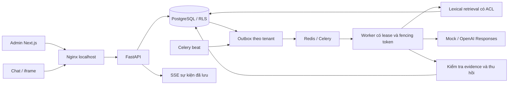

# Kiến trúc hiện tại và hướng triển khai v2

Snapshot code M0–M2 được rà soát ngày 13/11/2026; phần dưới mô tả hiện có, không phải toàn bộ target đã được triển khai. Mục tiêu v2 và khoảng trống xem master spec/P0–P5. Ngoài phạm vi: citizen auth, Actions, API hồ sơ, web/crawler/voice/image/code/MCP.

Next.js phục vụ `/admin`, `/chat/{public_key}`, `/embed/{public_key}`; widget loader chỉ nhúng cùng origin. Nginx chuyển `/api` và `/health` tới FastAPI, dùng DNS Docker động để không giữ IP container cũ khi API khởi động lại.

FastAPI xác định tenant từ directory public hoặc phiên Admin/chat. Request không tự đặt tenant. Mọi transaction nghiệp vụ đặt `app.tenant_id` transaction-local; runtime role không sở hữu bảng, không superuser/BYPASSRLS. CLI có credential migration nhưng hạ về runtime role khi làm việc trong một tenant.

Không giữ transaction/database connection suốt lời gọi model. Kết quả được buffer và kiểm tra trước khi công bố. SSE là sự kiện ứng dụng đã lưu, không phải raw reasoning/token stream. GET terminal result là đường phục hồi nếu stream đứt.

M2 bổ sung file → MinIO private → outbox → queue ingestion → ClamAV → parser/OCR tách mạng → sections/review → chunks. Parser không nhận DB/key và không truy cập internet; PDFium/Tesseract chạy trong subprocess có CPU/RAM/time limits. Duyệt công khai và release membership là các bước riêng; ready không có nghĩa published.

Vị trí nguồn gắn với trang PDF, sheet/range Excel, dòng CSV, slide hoặc mục DOCX/text; không bịa số trang DOCX. Table chunks Excel/CSV giữ context và hàng nguyên vẹn; bảng quá rộng trả lỗi thay vì cắt mất quan hệ dữ liệu.

Embedding profiles là catalog global Developer quản lý, runtime chỉ SELECT; vectors có tenant RLS/composite FK và kiểm tra dimension bằng trigger. Embeddings tắt mặc định. Developer reindex nguồn đã duyệt; query bật vector khi profile hợp lệ. PostgreSQL materialized CTE lọc ACL trước exact cosine, kết hợp lexical qua RRF. Chưa nghiệm thu semantic quality với model thật. Lời gọi query embedding hiện có timeout nhưng còn nằm trong transaction retrieval; cần tối ưu pool/latency và đo tải trước production.

Purge thu hồi trước, xóa object/chunks/vectors/sections/review text và nội dung đáp án dẫn xuất, giữ version IDs/tombstone để lịch sử release không phá FK. Lease/fencing ngăn worker cũ đưa nội dung đã thu hồi trở lại. Provider-copy deletion, backup deletion/restore và orphan sweeper chưa hoàn tất. Website sync và Action executor ngoài phạm vi v2. Mục tiêu còn phải làm: widget khác origin với domain/CSP, evaluation/live quality, MFA/budget/retention, load/backup/restore. Luồng chat AI không giữ transaction; query embedding là ngoại lệ còn cần tách, không coi kiến trúc mục tiêu đã đạt.

