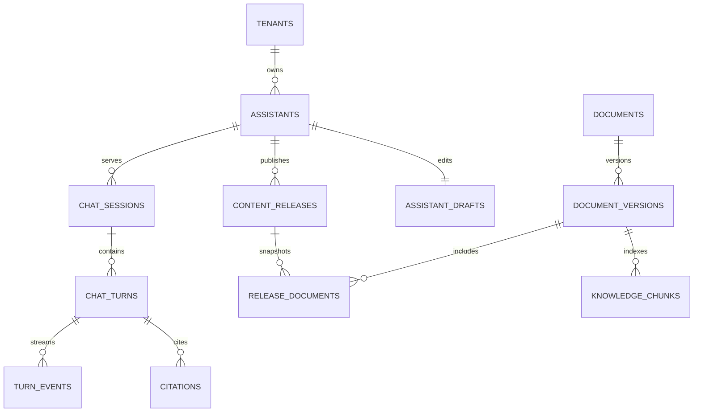

# Database và tenant isolation

Migrations `apps/api/migrations/versions/0001_*` tạo schema, vector extension, 20 bảng tenant-scoped, RLS và directory functions. `0002_preview_ownership.py` ràng buộc Preview với phiên Admin còn hiệu lực. Không dùng `create_all()` hoặc SQLite thay migration/RLS tests.

- Runtime: `citizen_runtime`, NOSUPERUSER/NOBYPASSRLS; không sở hữu bảng; không có credential migration trong API/worker/scheduler.
- Migration/operator: `citizen_migrator`, chỉ cấp cho one-shot migrate/ops/test harness. Transaction ops có tenant tự hạ role, không dựa vào RLS với tài khoản owner.
- Tất cả bảng nghiệp vụ có `tenant_id`; `tenants` dùng `id` làm ranh giới. Mỗi policy có USING/WITH CHECK, FORCE RLS; thiếu context không đọc được dữ liệu.
- Quan hệ tài liệu/version/chunk/release/session/turn/citation dùng composite FK có tenant. Một Admin active/phường bằng partial unique index; một turn queued/generating/session bằng unique partial index.
- Release/release membership/audit append-only được bảo vệ bằng quyền và trigger. Rollback tạo release mới, không sửa bản cũ và không phục hồi nguồn thu hồi.
- Token Admin/chat/CSRF lưu dạng HMAC hash. Directory SECURITY DEFINER chỉ exact-match định danh/token; search_path cố định, PUBLIC không có execute. Không trả nội dung hội thoại/tài liệu từ directory.

`0003_knowledge_files.py` thêm sections/review revisions, ingestion/deletion jobs, knowledge_outbox và chunk_embeddings; các bảng tenant mới đều FORCE RLS và composite FKs. Embedding_profiles là catalog global chỉ migration/Developer có quyền ghi; runtime chỉ SELECT. Trigger kiểm tra vector dimension theo profile; retrieval hiện exact search trong tập đã lọc, chưa ANN/load benchmark. Tham chiếu RLS: https://www.postgresql.org/docs/17/ddl-rowsecurity.html .

Purge giữ tombstone versions/release memberships nhưng xóa nội dung gốc/chunks/vectors/sections/review text. Citation chunk FK nullable với ON DELETE SET NULL; không xóa evidence version IDs để phá lịch sử. Đáp án dẫn xuất và SSE content được làm sạch trong job; đọc lại vẫn kiểm tra thu hồi độc lập. Không tự cấp BYPASSRLS để worker xử lý các tenant.

`0004_knowledge_management.py`/`0004_knowledge.sql` đã chạy tiến trên PostgreSQL local trong P1:

- document_versions có updated_at (bản cũ khởi tạo từ created_at), supersedes_version_id, approved_by/approved_at; quan hệ phiên bản và actor có tenant FK. Thêm index kho/metadata.
- upload_batches khóa theo tenant/client_request_id, gắn actor và fingerprint toàn payload; upload_receipts khóa theo tenant/operation_id, gắn batch và kết quả từng file. Cả hai bảng FORCE RLS, policy tenant, runtime grants rõ ràng.
- Upload/replay và sweep-orphans dùng advisory lock chung theo tenant để không xóa object upload đang chờ commit. Unknown COMMIT giữ object để đối soát sau grace, không xóa mù.
- Sửa metadata/review xóa approval audit; purge che filename trong receipt và để tombstone tối thiểu. Không khôi phục nội dung từ receipt sau purge.

Migration 0004 không có destructive downgrade tự động. Không reset DB hoặc xóa volume để áp dụng; dùng migration tiến và giữ backup theo quy trình vận hành. Test mới chạy PostgreSQL thật, kiểm RLS và composite FK; SQLite không thay thế.
